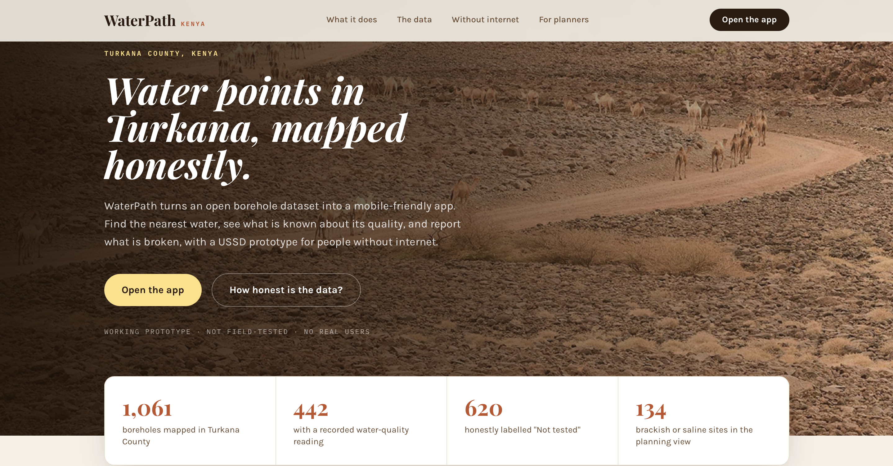

# WaterPath Kenya



**Live site:** https://waterpath-ke-1.onrender.com · **Source:** this repository

A prototype that helps people in Turkana County, Kenya, find nearby water points, see what is known about their water quality, and report problems. It turns an open borehole dataset into a mobile-friendly app, with a USSD option for people without internet.

**Status:** working prototype. It has not been field-tested and has no real users.

## What it does

**Community app**
- Ranks boreholes by distance from the user's browser location, with search by name or place and filters ("Safe water only", "Hide broken pumps")
- Shows all boreholes on a map, with a detail sheet: plain-language water guidance, flow, walking time and directions
- Anonymous 3-step problem reporting
- English and Kiswahili. The Turkana screen is a sign-up page for volunteer translators; the app is not yet translated.

**NGO dashboard (PIN-gated demo)**
- Map of water points with status controls
- Desalination planning panel built from the 134 boreholes with measured conductivity above 1,500 µS/cm

**Backend (Flask)**
- API for water points, reports and desalination sites
- SMS notification to a technician through Africa's Talking
- USSD endpoint for Africa's Talking (prototype)

## Pages

| Address | What it is |
|---|---|
| `/` | Product page: what WaterPath does, the data and its limits, the USSD prototype |
| `/app` | The community app: find water points, see the map, report a problem |
| `/dashboard` | NGO dashboard (PIN-gated demo) |

## Data

Source: [Boreholes Kenya - Rural Focus](https://ihp-wins.unesco.org/dataset/boreholes-kenya-rural-focus), UNESCO IHP-WINS (Rural Focus Ltd / SWAS Water Surveys; data originally from Water Resources Authority records).

- 1,062 Turkana County boreholes in the dataset; 1,061 are loaded in the app (one shared an existing borehole's coordinates)
- 442 have a conductivity (EC) reading; **620 have none and are shown as "Not tested"**
- Water-quality classes come from EC: up to 800 µS/cm excellent, up to 1,500 drinkable, up to 3,000 brackish, above that saline

**Limits of this data:** EC measures salinity only. It says nothing about bacteria or other contamination, so "Safe to drink" means "low salt in the last reading". The readings are historical and may be out of date. Treat the app as a guide for where to look and what to ask, not as a safety certificate.

## Machine-learning experiment (not used in the app)

I trained a Random Forest on the 433 boreholes with complete data to predict "safe" (EC up to 1,500) against "needs treatment" from latitude, longitude, depth and pH. It did not beat a trivial baseline:

| Measure | Result |
|---|---|
| Always predict "safe" (majority baseline, 304 of 433 are safe) | 70.2% |
| Random Forest, 5-fold CV | 68.4% |
| Random Forest, balanced accuracy | 53.4% (50% is chance) |
| Random Forest, spatial hold-out (whole regions held out) | 61.6% ± 14.1% |

Location, depth and pH carry little information about salinity, and 279 of 433 boreholes have no recorded depth. Predictions are therefore not shown anywhere in the app, and unmeasured boreholes are labelled "Not tested". Reproduce the check with `python ml/baseline_check.py` from `backend/`. Possible next steps: more features, a missing-depth indicator, and predicting EC directly.

## Tech stack

| Layer | Technology |
|---|---|
| Frontend | React 19, Vite, Tailwind CSS, Leaflet |
| Backend | Python 3.11, Flask, gunicorn |
| Database / auth | Firebase (Firestore, Authentication) |
| SMS / USSD | Africa's Talking |
| Hosting | Render (web service for the API, static site for the frontend) |

## Run locally

**Backend**
```bash
cd backend
python -m venv venv && source venv/bin/activate
pip install -r requirements.txt
```
Create `backend/.env` with:
```
FLASK_ENV=development
PORT=5000
FIREBASE_CREDENTIALS_PATH=./firebase-service-account.json
AFRICASTALKING_USERNAME=sandbox
AFRICASTALKING_API_KEY=your_key
ALLOWED_ORIGINS=http://localhost:5173
```
Put your Firebase service-account key at `backend/firebase-service-account.json` (git-ignored), then seed and run:
```bash
python scripts/seed_full_dataset.py --dry-run   # check the counts first
python scripts/seed_full_dataset.py
python app.py
```
`scripts/seed_firestore.py` loads only the 60-record sample.

**Frontend**
```bash
cd frontend
npm install
```
Create `frontend/.env.local` with the six `VITE_FIREBASE_*` values from your Firebase project and a `VITE_NGO_PIN` of your choice, then `npm run dev`. The frontend calls `/api/...`, so run the backend on the port set in `vite.config.js`, or add a dev proxy.

## Deployment

- **API:** Render web service, root directory `backend`, start command `gunicorn "app:create_app()" --bind 0.0.0.0:$PORT`, health check `/api/health`
- **Frontend:** Render static site, root directory `frontend`, build command `npm install && npm run build`, publish directory `dist`
- **Static site rewrite rules, in this order:** `/api/*` to the backend's `/api/*`, then `/*` to `/index.html`
- Without the `/*` to `/index.html` rewrite, reloading `/app` or `/dashboard` returns "not found"
- Free-tier services sleep after inactivity, so the first request can take about a minute

## Known limitations

- The NGO PIN is a client-side demo gate, not real authentication
- Firestore security rules need tightening before real use
- Only 60 of the boreholes originally had their status inferred by the seed script; statuses are rough and unverified
- Data is from a historical survey, and conductivity is the only quality measure

## Data credits

Borehole data: Rural Focus Ltd / SWAS Water Surveys via UNESCO IHP-WINS (published as open data; check the dataset page for current terms).

## License

MIT